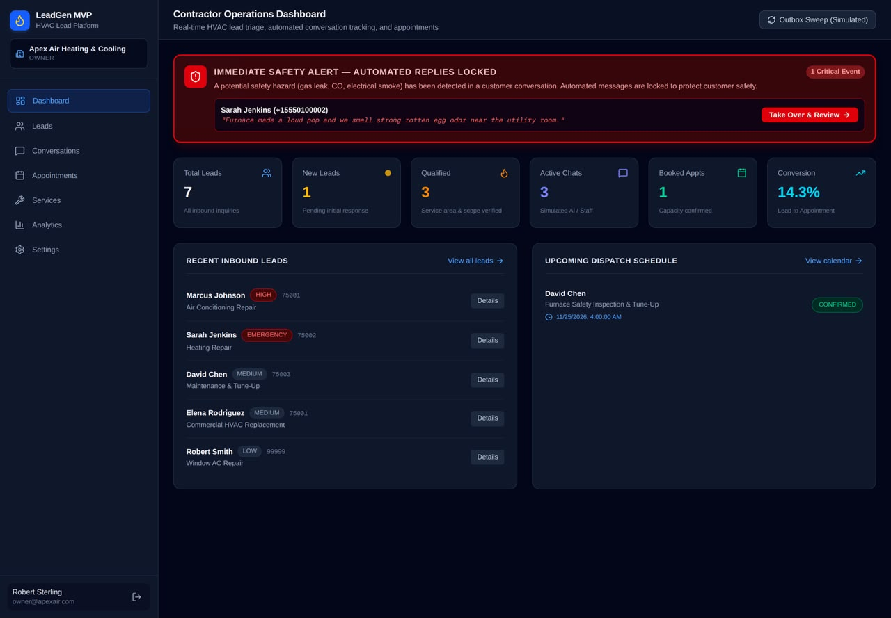
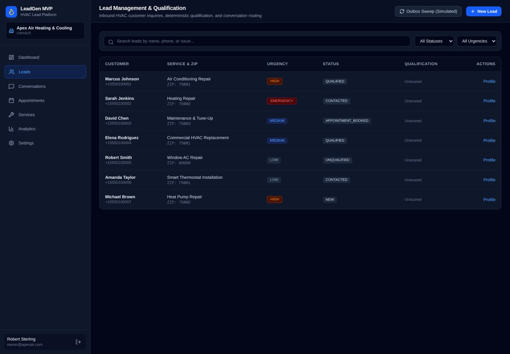
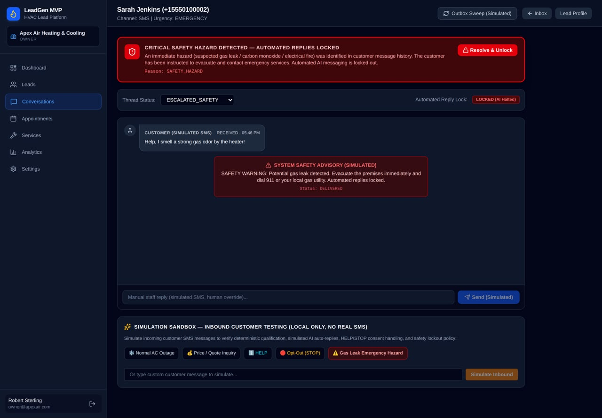

# Lead Capture Software (HVAC Lead Conversion Platform)

A multi tenant lead capture and conversion platform built for HVAC contractors.
It takes a new customer inquiry, records consent, qualifies the lead with a
deterministic rules engine, opens an SMS style conversation thread, and helps a
dispatcher book the appointment, all from one dashboard.

> Status: working MVP. Authentication, tenancy, lead management, qualification,
> conversations, appointments, public website lead capture, and Twilio/simulated
> outbound SMS are implemented. AI qualification and outbox event dispatch
> currently run in deterministic/simulated mode (see "What is simulated" below).

## Who it is for

Small and mid sized HVAC companies that lose jobs because nobody answers,
qualifies or follows up on new inquiries fast enough. Each company is an
isolated tenant organization with its own users, roles, leads and data.

## Features

- Organization sign up and JWT login with owner, admin, dispatcher and
  technician roles
- Public unauthenticated website lead capture (`POST /api/public/leads`) with
  site-key tenant resolution, sanitization, honeypot spam trap, and rate limiting
- Lead intake with phone normalization, email validation and SMS consent
  tracking (opt in and opt out honored, STOP keyword locks automation)
- Deterministic lead qualification with category, score, reasoning and a
  safety hazard screen (for example gas leak reports are escalated, never
  auto handled)
- Conversation threads per lead with assignment, escalation, human takeover,
  and Twilio SMS outbound delivery (simulated fallback when unconfigured)
- Appointment booking, rescheduling and cancellation
- Dashboard and analytics endpoints, transactional outbox for event delivery
- Optional gated demo dataset (`DEMO_ENABLED=true`) for local evaluations

## Screenshots

### Contractor Operations Dashboard


### Lead Management & Qualification


### Conversation Thread, Safety Lockout & Simulation Sandbox


## Quick start

Prerequisites: Docker (for Postgres, Redis and n8n), Python 3.12 with
[uv](https://docs.astral.sh/uv/) for the backend, and Node 20+ for the frontend.

1. Clone the repo and create your environment file:

   ```bash
   cp .env.example .env
   ```

   Edit `.env` and replace every placeholder secret, especially `SECRET_KEY`,
   `POSTGRES_PASSWORD` and `N8N_ENCRYPTION_KEY`.

2. Start the data services:

   ```bash
   docker compose -f infrastructure/docker-compose.yml up -d
   ```

3. Run the backend (from the `backend/` folder):

   ```bash
   uv sync
   uv run alembic upgrade head
   uv run uvicorn app.main:app --app-dir src --reload --port 8000
   ```

   API docs are then at http://localhost:8000/docs and the health check at
   http://localhost:8000/health

4. Run the frontend (from the `frontend/` folder):

   ```bash
   npm install
   npm run dev
   ```

   The dashboard is at http://localhost:3000

5. Optional demo data: demo mode is **disabled by default** (`DEMO_ENABLED=false`).
   To enable it in local development, set `DEMO_ENABLED=true` and `DEMO_PASSWORD`
   in `.env` (never enable demo mode in production). Then `POST /api/demo/seed`
   creates a sample contractor ("Apex Air Heating & Cooling") and
   `GET /api/demo/info` lists the demo logins and test scenarios.

## Configuration

All configuration is through environment variables; see `.env.example` for the
full annotated list. The important ones:

| Variable | Purpose |
| --- | --- |
| `SECRET_KEY` | Signs JWT access tokens. Must be long, random and private |
| `DATABASE_URL` | Async Postgres connection string for the API |
| `REDIS_URL` | Redis connection for token revocation and queues |
| `AI_PROVIDER` / `OPENAI_API_KEY` | Reserved for AI qualification (see below) |
| `MESSAGING_MODE` | `simulated` (default) or `twilio` (requires `TWILIO_ACCOUNT_SID`, `TWILIO_AUTH_TOKEN`, `TWILIO_PHONE_NUMBER`) |
| `CALENDAR_MODE` | `simulated` or `google_calendar` |
| `DEMO_ENABLED` / `DEMO_PASSWORD` | `false` by default; both must be set to expose `/api/demo/*` (never in production) |
| `ENVIRONMENT` | Set to `production` to enforce production guards |

## What is simulated in this MVP

Being straight about the boundary between real and simulated matters more than
a long feature list:

- **Public website lead capture is real**: `POST /api/public/leads` accepts
  unauthenticated website embed submissions using a contractor `X-Site-Key` /
  `X-API-Key`, validates and sanitizes inputs, applies rate limiting and a
  honeypot spam field, and runs the full lead intake and qualification flow.
- **Outbound SMS supports real Twilio delivery**: When `MESSAGING_MODE=twilio`
  and `TWILIO_ACCOUNT_SID`, `TWILIO_AUTH_TOKEN`, and `TWILIO_PHONE_NUMBER` are
  configured, outbound messages on SMS conversations send through the Twilio
  REST API and log delivery status and receipt SIDs on the conversation thread.
  When Twilio credentials are absent, it defaults to the local simulated sender.
- **Event dispatch through the outbox is simulation only**: No OpenAI calls or
  external n8n webhooks fire yet; the outbox claiming, retries, lease fencing,
  and audit trail are real, while external outbox dispatches are stubbed.
- **Lead qualification is a deterministic rules engine**, not an LLM call. The
  OpenAI settings exist for the planned AI mode.
- **The `automation/` folder and n8n service are scaffolding**: n8n runs, but
  no production workflows ship in this repo yet.

## Project structure

```text
backend/         FastAPI API (Python 3.12, SQLAlchemy async, Alembic, pytest)
  src/app/       api routers, core, models, schemas, repositories, services
  tests/         146+ tests (most need a running Postgres, see backend/README)
frontend/        Next.js 16 dashboard (React 19, Tailwind 4, TypeScript)
infrastructure/  docker-compose for Postgres 16, Redis 7 and n8n
automation/      planned n8n workflow exports (empty in this MVP)
docs/            additional documentation
.env.example     annotated environment template
```

## Tests

Backend: `cd backend && uv run pytest` with Postgres and Redis running (the
suite creates throwaway databases from `DATABASE_URL`). The schema and model
metadata tests also pass without a database.

## License

Copyright (c) 2026 Syed Ahmed Hussain. All rights reserved. This is proprietary software; contact the owner for licensing.
